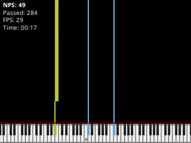
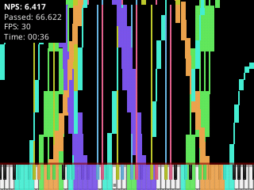

<div align="center">

# Piano From Above (PFA) for KaiOS


<p>
  
  
  
</p>

</div>

**Piano From Above (PFA)** for **KaiOS 2.5 and KaiOS 3.0+** is a MIDI visualizer optimized for smart feature phones (Nokia 2720 Flip, Nokia 8000 4G, Nokia 6300 4G, Nokia 8110 4G, JioPhone, etc.).

<p align="center">
  
  
</p>

This project focuses on optimizing the Canvas rendering pipeline to smoothly display high-density **Black MIDI** tracks with massive note counts on hardware-constrained KaiOS devices.

---

## Key Features

* **Black MIDI Optimization:** Lightweight rendering algorithms handle tens of thousands of notes without severe FPS drops.
* **Physical Keypad Support:** Smooth navigation and control using the D-Pad and number keys.
* **Highly Customizable:** Supports a full 128-key piano display, customizable track colors, and adjustable note falling speeds.
* **WebAudio Synthesizer:** Built-in lightweight audio synth that minimizes RAM usage on low-end devices.

---

## Installation Guide

The repository contains two builds. Pick the one that matches your phone:

| Your phone runs | Use folder | Manifest file |
|---|---|---|
| **KaiOS 2.5.x** | `pfa-src_2.5/` | `manifest.webapp` |
| **KaiOS 3.0 and newer** | `pfa-src_3.0/` | `manifest.webmanifest` |

> **Important:** the two builds are **not interchangeable**. Do not install the 2.5 build on KaiOS 3.0 or vice versa.

---

## Installation Guide for KaiOS 2.5

To install this app on your KaiOS 2.5 device, choose **one of the three methods** below:

### Prerequisites
Enable **Debug Mode** on your KaiOS 2.5 phone:
1. Open the Phone app and dial: `*#*#33284#*#*` *(a bug icon will appear in the status bar)*.
2. Or go to **Settings > Device > Developer > Debugger > Select ADB & DevTools**.

---

### Method 1: WebIDE / Waterfox Classic (For Developers & Direct Sideloading)

1. **Preparation:**
   * Download [ADB Platform Tools](https://developer.android.com/studio/releases/platform-tools) on your computer.
   * Download a WebIDE-compatible browser like **Waterfox Classic** or **Firefox v59 / ESR 52**.
2. **Connect Phone to PC:**
   * Connect your phone to your PC via USB cable.
   * Open Terminal / Command Prompt and verify the connection:
     ```bash
     adb devices
     ```
   * Forward the debugger port (for KaiOS 2.5):
     ```bash
     adb forward tcp:6000 localfilesystem:/data/local/debugger-socket
     ```
3. **Install Application:**
   * Open **Waterfox Classic / Firefox** and press `Shift + F8` to open **WebIDE**.
   * In the right panel, select **Remote Runtime** (Port `6000`).
   * In the left panel, select **Open Packaged App...** and select the `pfa-src_2.5` folder (containing `manifest.webapp`).
   * Click the **Play** (Triangle) button in the top toolbar to build and run the app directly on your phone.

---

### Method 2: OmniSD / Gerda File Manager / Wallace Toolbox (.zip File)

1. **Package the App:**
   * Zip all files inside `pfa-src_2.5` (including manifest.webapp, index.html, js/, style/, locales-obj/) into a `.zip` archive (e.g., `pfa.zip`).
   * *Note:* Zip the contents directly inside `pfa-src_2.5`, not the folder itself.
2. **On your Phone:**
   * Copy `pfa.zip` to your SD card or internal storage.
   * Open **OmniSD**, **Gerda File Manager**, or **Wallace Toolbox** on KaiOS 2.5.
   * Select `pfa.zip` and press **Install**.
   * Once installed, **Piano From Above** will appear on your app launcher menu.

---

### Method 3: Direct Download from the Store (Easiest)

1. Open the **Store** app on your KaiOS 2.5 phone.
2. Search for **Piano From Above**.
3. Press **Download/Install** and open it from your app launcher menu once installed.

---

## Installation Guide for KaiOS 3.0 and newer

To install this app on a KaiOS 3.0+ device, choose **one of the three methods** below. Use the **`pfa-src_3.0`** folder for Methods 1 and 2.

### Prerequisites
For Methods 1 and 2, enable **Debug Mode** on your KaiOS 3.0+ phone:
1. Open the Phone app and dial: `*#*#33284#*#*` *(a bug icon will appear in the status bar)*.
2. Or go to **Settings > Device > Developer > Debugger > Select ADB and DevTools**.

Method 3 does not need Debug Mode.

---

### Method 1: appscmd (For Developers & Direct Sideloading)

1. **Preparation:**
   * Download [ADB Platform Tools](https://developer.android.com/studio/releases/platform-tools) on your computer.
   * Download `appscmd` from the official [KaiOS appscmd repository](https://github.com/kaiostech/appscmd) and rename the binary for your OS to `appscmd`.
     * macOS / Linux: run `chmod +x appscmd`.
     * Verify with `./appscmd --help`.
2. **Connect Phone to PC:**
   * Connect your phone to your PC via USB cable (Debug Mode must be on).
   * Open Terminal / Command Prompt, verify the connection and get root access:
     ```bash
     adb devices
     adb root
     ```
   * Forward the debugger port:
     ```bash
     adb forward tcp:6000 localfilesystem:/data/local/debugger-socket
     ```
3. **Install Application:**
   * Install directly from the `pfa-src_3.0` folder (it contains `manifest.webmanifest`):
     ```bash
     ./appscmd install /path/to/pfa-src_3.0
     ```
   * Once installed, **Piano From Above** will appear on your app launcher menu.

Useful commands:
```bash
./appscmd list                 # list installed apps
./appscmd uninstall <app_name> # remove an app
```

> See the official guide: [KaiOS OS ENV Setup (SFP 3.0)](https://developer.kaiostech.com/docs/sfp-3.0/getting-started/env-setup/os-env-setup/).

---

### Method 2: OStore (.zip File)

[OStore](https://github.com/gogogoghost/ostore-solid) (OStore-Solid) is a community app store for KaiOS 3.x, also built into the system image of the Nokia 2780 Flip jailbreak.

1. **Package the App:**
   * Zip all files inside `pfa-src_3.0` (including `manifest.webmanifest`, `index.html`, `sw.js`, `js/`, `style/`, `locales-obj/`) into a `.zip` archive (e.g., `pfa-3.0.zip`).
   * *Note:* Zip the contents directly inside `pfa-src_3.0`, not the folder itself.
2. **On your Phone:**
   * Copy `pfa-3.0.zip` to your SD card or internal storage.
   * Open **OStore** on your KaiOS 3.0+ phone.
   * Navigate to **Manual install** and choose **Install app from zip file**.
   * Select `pfa-3.0.zip` to install it.
   * Once installed, **Piano From Above** will appear on your app launcher menu.

---

### Method 3: Direct Download from the Store (Easiest)

1. Open the **Store** app on your KaiOS 3.0 phone.
2. Search for **Piano From Above**.
3. Press **Download/Install** and open it from your app launcher menu once installed.

---

## Contributing

Contributions to optimize Canvas rendering performance or reduce memory consumption for massive Black MIDI files are highly appreciated!

1. Fork this repository.
2. Create a feature branch (`git checkout -b feature/OptimizeCanvas`).
3. Commit your changes (`git commit -m 'Optimize frame rendering time'`).
4. Push to the branch (`git push origin feature/OptimizeCanvas`).
5. Open a **Pull Request**.

---

## TODO

* Fix audio playback while running.

---

## License

This project is released under the [MIT License](LICENSE).
